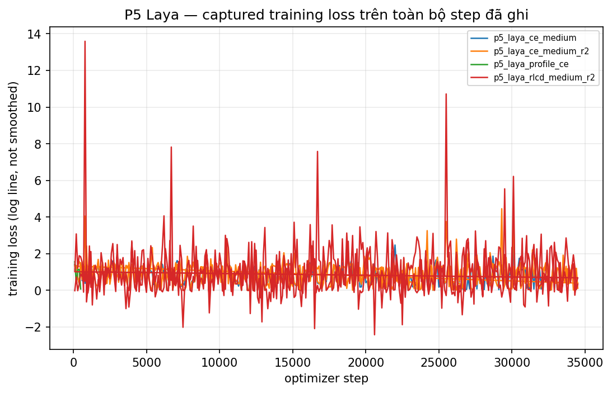
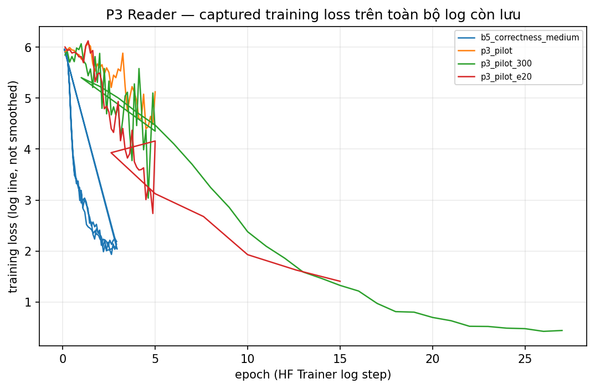

# BÁO CÁO CUỐI KỲ — HỆ TÁC TỬ HỎI ĐÁP TIẾNG VIỆT THÍCH NGHI

- **Tên đề tài:** Hệ tác tử hỏi đáp tiếng Việt thích nghi sử dụng Reinforcement Learning và mô hình quyết định Jev-like.
- **Tên Anh:** Vietnamese Adaptive QA Agent with RLCD and Sequential Policy Learning.
- **Học phần:** Reinforcement Learning / Học tăng cường.
- **Nhóm/Sinh viên/Giảng viên/Đơn vị:** chưa có trong artifact — điền tay tại đây.
- **Ngày hoàn thành (sinh báo cáo):** 2026-10-09T09:18:21+00:00
- **Git SHA:** b84044cfa4cdaf1af5fa9a1d914a4187d3555629
- **Reader model hash:** f05b24ee68f2e6bbd43ea2e2ab1e1ab36be12dfd9e6924079867b8eb212f54e8 | **ngưỡng null-score-diff:** 0.500000

## Tóm tắt / Abstract

Đồ án xây dựng một tác tử hỏi đáp trích xuất tiếng Việt trên kho văn bản đóng, trong đó tác tử quyết định tuần tự khi nào tìm thêm bằng chứng bằng BM25 hay Dense, khi nào trả lời và khi nào từ chối, với chi phí tìm kiếm nằm trong hàm thưởng. Mô hình quyết định gồm một prior Laya được chuyên biệt hóa bằng RLCD (so sánh với Soft-CE) và một policy REINFORCE tối ưu episodic reward trên cùng môi trường, cùng reader và cùng ngân sách tìm kiếm với mọi baseline. Báo cáo này được sinh hoàn toàn từ artifact đã ghi: các bảng E00–E07 lấy từ reports/tables/baseline_results_*.csv, chỉ số retrieval từ reports/retrieval_report.json, cấu hình và thời lượng từ runs/index.jsonl và các manifest. Kết quả chính: dòng tốt nhất theo token F1 hiện có là E02 trên test_strict (F1=0.330448, N=4260); các giả thuyết H1–H4 và trạng thái supported/not supported/inconclusive được ghi tại mục 10 kèm bằng chứng file. Từ khóa: RL, Reinforcement Learning, Vietnamese QA, Adaptive Retrieval, RLCD, Calibration, Abstention.

## 1. Giới thiệu và phát biểu vấn đề

- Bài toán: trả lời đúng câu hỏi tiếng Việt trên kho tài liệu đóng, hạn chế hallucination và chi phí truy hồi; câu trả lời phải trích từ bằng chứng đã thấy, hoặc từ chối.
- RAG cố định (retrieve-k rồi trả lời) so với tác tử chủ động quyết định thu thập bằng chứng từng bước; đây là bài toán điều khiển, không phải sinh văn bản.
- Không gian hành động 4 lựa chọn: ANSWER, SEARCH_BM25, SEARCH_DENSE, ABSTAIN; episode kết thúc khi trả lời/từ chối hoặc hết ngân sách tìm kiếm, sau đó hệ thống buộc quyết định.
- Bốn câu hỏi nghiên cứu (pre-registered, `01_SPECIFICATIONS/01` §3):
  - **RQ1 (calibrated decisions):** trên cùng dữ liệu teacher, RLCD so với Soft-CE có cải thiện calibration, action accuracy và tỷ lệ chọn hành động đúng không?
  - **RQ2 (sequential RL):** policy REINFORCE trên feature Laya có tăng episodic reward so với threshold, SFT policy và chiến lược cố định dưới cùng chi phí không?
  - **RQ3 (retrieval choice):** policy biết chọn BM25 vs Dense và thời điểm dừng có đem lại Pareto trade-off Answer F1 / retrieval cost tốt hơn không?
  - **RQ4 (robustness, tùy chọn):** chính sách có chịu được thay đổi noise, chất lượng retrieval, ngân sách tìm kiếm và câu hỏi không có đáp án không?
- Giả thuyết H1–H4 (`01_SPECIFICATIONS/01` §4) và kết quả kiểm định ở mục 10; không tuyên bố kết quả trước khi đo.

## 2. Cơ sở lý thuyết

- MDP hữu hạn với quan sát đã thấy: state gồm câu hỏi, các đoạn đã xem, candidate của reader, thống kê truy hồi và lịch sử hành động; policy ngẫu nhiên theo REINFORCE (policy gradient, baseline, entropy regularization, gamma=1).
- RLCD/Laya/Jev: mô hình ra **quyết định** (choice + probabilities) tách biệt với reader trả **câu trả lời**; không fine-tune Jev gốc và không claim như vậy.
- Calibration (ECE/Brier) đo chất lượng xác suất p_correct của baseline threshold; xác suất chọn hành động của policy **không phải** xác suất đáp án đúng.
- Retrieval BM25 (Okapi) so với dense E5 multilingual (prefix query:/passage:); reader XLM-R base được SFT trích xuất với cơ chế no-answer kiểu SQuAD2.
- Related work: Adaptive-RAG (chọn chiến lược theo độ khó), Search-R1 (RL cho multi-turn search) — khác biệt ở quy mô nhỏ, tiếng Việt, cost-aware và có abstention.

## 3. Dữ liệu, giấy phép và chia tập

- Nguồn: taidng/UIT-ViQuAD2.0, revision 406f09a45cc106a8f7b7fd0c25078883fe58cb1f (pin tại thời điểm tải, ghi trong data/raw/source_manifest.json).
- Số dòng raw đã dùng: {"test": 7301, "train": 28454, "validation": 3814}; số dòng strict mỗi tập: {}; profile=medium.
- Chia tập strict theo title-group (không rò rỉ tiêu đề giữa các tập); chi tiết merge near-duplicate và tỷ lệ trong data/processed/split_manifest.json.
- Ngữ nghĩa `is_impossible`: câu hỏi không có đáp án trong ngữ cảnh; strict test labels chỉ được mở cho lần đánh giá cuối (xem docs/TEST_ACCESS_LOG.md).
- Giấy phép dữ liệu: card_license=N/A — **UNVERIFIED**: license phân phối chưa được xác thực độc lập, không xuất bản lại raw dataset/checkpoint nếu chưa rà soát (05_TEMPLATES/04).

## 4. Phương pháp đề xuất

- Kiến trúc: BM25 + Dense index trên kho đóng → QA reader trích xuất (XLM-R SFT, ngưỡng null-score-diff chọn trên val) → mô hình quyết định (Laya RLCD/CE hoặc policy REINFORCE MLP) → hành động, lặp lại tới khi kết thúc episode.
- Câu trả lời luôn là span trích từ đoạn đã truy hồi (kèm doc_id và offset); không sinh văn bản mới; câu từ chối cố định: “Chưa tìm thấy bằng chứng đủ để trả lời trong bộ tài liệu hiện tại.”
- State/action mask/terminal theo `src/rl/env.py`; episode mặc định: 1 lượt bootstrap bắt buộc + tối đa 2 lượt tìm tùy chọn; mỗi lượt tìm mở thêm 1 đoạn.
- Reward (configs/base.yaml `reward:`): bm25_cost=0.1, bootstrap_bm25_cost=0.1, candidate_f1_threshold=0.8, correct_abstain=0.8, correct_answer=2.0, dense_cost=0.25, force_provenance=True, gamma=1.0, unnecessary_abstain=-1.0, wrong_answer=-2.0 — chi phí bootstrap: 0.100000.
- Teacher cho Laya: quy tắc soft (temperature, tie-order) từ reward, không dùng oracle gold để chọn hành động; anti-leakage kiểm tra bằng `find_forbidden_keys`.
- RL: REINFORCE on-policy, greedy eval, feature 33 chiều (số liệu + prior Laya), scaler chuẩn hóa đi kèm checkpoint; cache Laya probabilities theo (qid, state_hash).
- Tài nguyên 24GB: microbatch nhỏ + gradient accumulation, cache state/predictions trên đĩa, giải phóng encoder sau khi dùng.

## 5. Cài đặt và môi trường

- GPU: NVIDIA L4 | VRAM 23034 MiB | driver 580.178.04; Torch 2.14.1+cu130, CUDA runtime 13.0.
- Host: Linux-6.8.0-1069-gcp-x86_64-with-glibc2.35; CPU 4 lõi; RAM 15990 MiB; disk free 50.300000 GB.
- Preflight: READY_FOR_TRAIN; blockers: [].
- Git SHA: b84044cfa4cdaf1af5fa9a1d914a4187d3555629; seed mặc định 42; profile medium; reader max_len=384, doc_stride=128, max_answer_length=30.
- Lệnh chạy từng stage: xem REPRODUCE.md và bảng ở FINAL_HANDOFF.md; mọi stage ghi manifest + dòng registry với SHA256.

## 6. Thiết kế thí nghiệm

| Mã | Baseline | Quyết định | Prior | Dữ liệu train | Ghi chú |
|---|---|---|---|---|---|
| E00 | B1 | Rule bootstrap: trả lời/từ chối ngay sau bootstrap | N/A | — | zero adaptation |
| E01 | B2 | Fixed BM25 tới hết ngân sách tìm tùy chọn | N/A | — | fixed keyword retrieval |
| E02 | B3 | Fixed Dense tới hết ngân sách tìm tùy chọn | N/A | — | fixed semantic retrieval |
| E03 | B5 | Ngưỡng p_correct hiệu chuẩn trên val | N/A | — | classical adaptive baseline |
| E04 | B6 | Laya CE: masked argmax | ce | train strict | supervised decision model |
| E05 | B7 | Laya RLCD: masked argmax | rlcd | train strict | calibrated decision model |
| E06 | B8 | REINFORCE MLP trên prior RLCD (agent chính) | rlcd | train strict | main RL agent |
| E07 | B8 | REINFORCE MLP trên prior CE (tùy chọn) | ce | train strict | isolates the RLCD increment |

- Cùng qid, cùng docs/scenario seed, cùng reader, cùng ranking, cùng mask/horizon và cùng trọng số reward cho mọi dòng E00–E07 (fairness trong reports/baseline_report_val.json).
- Profile: medium; selection: mean episodic reward trên validation, freeze trước test — trạng thái best_selection.json: có.
- Test strict chỉ chạy một lần sau khi khoá lựa chọn; access log ở docs/TEST_ACCESS_LOG.md; CI theo cụm title-group (cluster bootstrap) khi đủ dữ liệu.

## 7. Kết quả quantitative — KHÔNG ĐƯỢC BỎ

**Bảng 1 — Môi trường và thời lượng đo được** (nguồn: outputs/diagnostics/*, runs/index.jsonl; giây = RUNNING đầu → dòng kết thúc cuối):

| Giai đoạn | Stage | Trạng thái | Giây (đo được) |
|---|---|---|---|
| P1 | download | NOT_RUN | N/A |
| P1 | audit_split | SUCCEEDED | 240.000000 |
| P2 | build_retrieval | SUCCEEDED | 27148.000000 |
| P3 | train_reader | SUCCEEDED | 646.000000 |
| P3 | cache_reader | SUCCEEDED | 1244.000000 |
| P5 | make_teacher | SUCCEEDED | 172.000000 |
| P5 | train_laya_ce | SUCCEEDED | 16002.000000 |
| P5 | train_laya_rlcd | SUCCEEDED | 16084.000000 |
| P5 | cache_laya | SUCCEEDED | 3557.000000 |
| P6 | train_rl | SUCCEEDED | 1525.000000 |
| P6 | select_rl | SUCCEEDED | 0.000000 |
| P8 | train_correctness | SUCCEEDED | 1740.000000 |
| P7 | eval_baselines | SUCCEEDED | 1143.000000 |
| P9 | report | SUCCEEDED | N/A |

**Bảng 1b — Nhật ký huấn luyện**: mỗi dòng là một `run_id` trong runs/index.jsonl của các stage train (P3_reader, P3_reader_overfit_smoke, P5_laya_train, P6_rl, B5_correctness); ‘Phút’ = dòng RUNNING đầu → dòng kết thúc cuối của cùng run_id, run còn chạy đo đến lúc sinh báo cáo và đánh dấu ĐANG CHẠY. Tổng 14 lần chạy: INTERRUPTED=2, SKIPPED=1, SUCCEEDED=8, SUPERSEDED=3.

| Lần chạy (run_id) | Stage | Profile | Trạng thái cuối | Bắt đầu (UTC) | Kết thúc (UTC) | Phút | Ghi chú |
|---|---|---|---|---|---|---|---|
| p3-reader-medium-2026-10-08T144009+0000 | P3_reader | medium | SUCCEEDED | 2026-10-08 14:40 | 2026-10-08 14:41 | 1.600000 | N/A |
| p3-reader-medium-2026-10-08T144826+0000 | P3_reader | medium | SUCCEEDED | 2026-10-08 14:48 | 2026-10-08 14:57 | 9.200000 | N/A |
| p5-laya-ce-medium-2026-10-09T005941+0000 | P5_laya_train | medium | SKIPPED | 2026-10-09 00:59 | 2026-10-09 01:01 | 1.800000 | dry-run: no training performed |
| p5-laya-ce-medium-2026-10-09T010137+0000 | P5_laya_train | medium | INTERRUPTED | 2026-10-09 01:01 | 2026-10-09 03:09 | 127.600000 | RUNNING nhưng process không còn sống (pgrep không thấy); đánh dấu INTERRUPTED theo spec 06 §5 (INTERRUPTED không có trong STATUSES) |
| p5-laya-ce-medium-2026-10-09T031007+0000 | P5_laya_train | medium | INTERRUPTED | 2026-10-09 03:10 | 2026-10-09 03:12 | 2.300000 | attempt started non-detached by mistake (would die with the session, as the 01:01 run did); SIGTERM by the operator ~1 min in, outputs/models/laya_ce absent, before any training step was logged; relaunched detached via setsid |
| p5-laya-ce-medium-2026-10-09T031230+0000 | P5_laya_train | medium | SUCCEEDED | 2026-10-09 03:12 | 2026-10-09 07:37 | 264.900000 | N/A |
| p5-laya-rlcd-medium-2026-10-09T033300+0000 | P5_laya_train | medium | SUCCEEDED | 2026-10-09 03:33 | 2026-10-09 08:01 | 268.100000 | N/A |
| b5-correctness-medium-42-2026-10-09T080314+0000 | B5_correctness | medium | SUCCEEDED | 2026-10-09 08:03 | 2026-10-09 08:32 | 29.000000 | N/A |
| p6-rl-medium-42-2026-10-09T083435+0000 | P6_rl | medium | SUPERSEDED | 2026-10-09 08:34 | 2026-10-09 08:41 | 7.000000 | 3 seed chạy song song cùng ghi canonical outputs/models/rl_policy (vi phạm quy tắc 1 output dir của D018); archive bị lẫn trạng thái run khác (config.json seed != seed của run_id; policy.safetensors trùng byte giữa các seed). Đã cách ly, rerun tuần tự. SUPERSEDED ngoài STATUSES — bản ghi chú thủ công, select_rl bỏ qua status ngoài TERMINAL và dir đã ra khỏi outputs/models/rl_runs/. |
| p6-rl-medium-43-2026-10-09T083435+0000 | P6_rl | medium | SUPERSEDED | 2026-10-09 08:34 | 2026-10-09 08:41 | 7.000000 | 3 seed chạy song song cùng ghi canonical outputs/models/rl_policy (vi phạm quy tắc 1 output dir của D018); archive bị lẫn trạng thái run khác (config.json seed != seed của run_id; policy.safetensors trùng byte giữa các seed). Đã cách ly, rerun tuần tự. SUPERSEDED ngoài STATUSES — bản ghi chú thủ công, select_rl bỏ qua status ngoài TERMINAL và dir đã ra khỏi outputs/models/rl_runs/. |
| p6-rl-medium-44-2026-10-09T083436+0000 | P6_rl | medium | SUPERSEDED | 2026-10-09 08:34 | 2026-10-09 08:41 | 7.000000 | 3 seed chạy song song cùng ghi canonical outputs/models/rl_policy (vi phạm quy tắc 1 output dir của D018); archive bị lẫn trạng thái run khác (config.json seed != seed của run_id; policy.safetensors trùng byte giữa các seed). Đã cách ly, rerun tuần tự. SUPERSEDED ngoài STATUSES — bản ghi chú thủ công, select_rl bỏ qua status ngoài TERMINAL và dir đã ra khỏi outputs/models/rl_runs/. |
| p6-rl-medium-42-2026-10-09T084141+0000 | P6_rl | medium | SUCCEEDED | 2026-10-09 08:41 | 2026-10-09 08:43 | 1.600000 | N/A |
| p6-rl-medium-43-2026-10-09T084318+0000 | P6_rl | medium | SUCCEEDED | 2026-10-09 08:43 | 2026-10-09 08:44 | 1.400000 | N/A |
| p6-rl-medium-44-2026-10-09T084444+0000 | P6_rl | medium | SUCCEEDED | 2026-10-09 08:44 | 2026-10-09 08:46 | 1.600000 | N/A |

**Bảng 1c — Log loss còn lưu**: 8/41 tệp log quét được có dòng loss parse được (nguồn: outputs/runs/logs/ và logs/); log của lần chạy cũ không còn stdout thì không xuất hiện — không suy diễn số thiếu:

| Tệp log | Trainer | Số điểm | Đầu → cuối | Loss cuối | Loss min |
|---|---|---|---|---|---|
| b5_correctness_medium.log | Reader (epoch) | 96 | 0.09249 → 2.914 | 2.188000 | 1.934000 |
| p5_laya_ce_medium.log | Laya (step) | 334 | 100 → 33400 | 0.109100 | 0.000300 |
| p5_laya_ce_medium_r2.log | Laya (step) | 690 | 100 → 34500 | 0.112000 | 0.000000 |
| p5_laya_profile_ce.log | Laya (step) | 5 | 100 → 500 | 0.075300 | 0.075300 |
| p5_laya_rlcd_medium_r2.log | Laya (step) | 690 | 100 → 34500 | 0.336600 | -2.425600 |
| p3_pilot.log | Reader (epoch) | 40 | 0.125 → 5 | 5.124000 | 4.399000 |
| p3_pilot_300.log | Reader (epoch) | 67 | 0.125 → 27 | 0.442000 | 0.424800 |
| p3_pilot_e20.log | Reader (epoch) | 46 | 0.125 → 15 | 1.407000 | 1.407000 |

**Hình 1b — loss P5 Laya theo optimizer step, mỗi đường là một log còn lưu:**

**Hình 1c — loss P3 Reader theo epoch, mỗi đường là một log còn lưu:**

**Bảng 2a — Retrieval** (nguồn: reports/retrieval_report.json; scenarios=13658, câu trả lời được=9322):

| Chỉ số | BM25 | Dense | Ghi chú |
|---|---|---|---|
| Recall@1 | 0.853894 | 0.932954 | N/A |
| Recall@3 | 0.942394 | 0.981978 | N/A |
| Recall@5 | 0.971251 | 0.995065 | union=0.998284 |
| MRR | 0.904425 | 0.958852 | N/A |
| Tỷ lệ reachable trong ngân sách | 0.942394 | 0.967818 | ngân sách: bm25=3, dense=2 |
| Top-k overlap / diff rate | N/A | N/A | 0.400578 / 0.929712 |

**Bảng 2b — Reader** (nguồn: outputs/models/qa_reader/reader_eval.json; n=4399, ngưỡng null-score-diff=0.500000, model hash=f05b24ee68f2e6bbd43ea2e2ab1e1ab36be12dfd9e6924079867b8eb212f54e8):

| Chỉ số | Oracle-context | Retrieved-context | Ghi chú |
|---|---|---|---|
| EM (câu trả lời được) | 0.289990 | 0.270035 | trần của agent khi reader thấy ngữ cảnh vàng |
| F1 (câu trả lời được) | 0.475674 | 0.437405 | bằng chứng thực tế agent thấy |
| EM (toàn bộ) | 0.274835 | 0.237327 | gồm cả câu không có đáp án |
| No-answer accuracy | 0.238390 | 0.158669 | N/A |
| False answer rate (impossible) | 0.761610 | 0.841331 | càng thấp càng tốt |
| Provenance failures | 0 | 0 | span phải nằm trong context đã thấy |
| Đã trả lời (answerable) | 2475 | 2684 | trên 3107 câu trả lời được |

Acceptance của P3 (`train_reader`): mọi kiểm tra đạt (5 mục)

**Bảng 3 — Laya CE vs RLCD** (nguồn: outputs/manifests/P5_train_laya_*.json; các chỉ số teacher-action accuracy/ECE cần đánh giá riêng — chưa có artifact, ghi NOT_RUN):

| Checkpoint | Regime | Loss | Data SHA256 | Train N | Calib N | Temperature | Epoch loss | Walltime (s) | Peak VRAM (MiB) | Status |
|---|---|---|---|---|---|---|---|---|---|---|
| laya_ce | ce | soft-ce | 1fb2ee70be535aab12cdb503f84d2bc3ecf741f4e37a0ef9a42e9daa2a503ecc | 34593 | 400 | [1.160843014717102, 1.0, 1.0] | [0.9345533608895623, 0.8403998328312645] | 15890.700000 | 6139.400000 | SUCCEEDED |
| laya_rlcd | rlcd | rlcd | 1fb2ee70be535aab12cdb503f84d2bc3ecf741f4e37a0ef9a42e9daa2a503ecc | 34593 | 400 | [3.929617404937744, 1.0, 1.0] | [0.8426736192447989, 0.9058278330168141] | 16078.600000 | 6139.400000 | SUCCEEDED |

**Bảng 3b — Hyperparameter đã chạy của 2 lần Laya** (nguồn: outputs/manifests/P5_train_laya_{ce,rlcd}_medium.json, khối `config` as-run; hai regime cùng điều kiện theo spec 04 §5):

| Thông số | CE | RLCD |
|---|---|---|
| epochs | 2 | 2 |
| micro_batch | 1 | 1 |
| grad_accum | 8 | 8 |
| encoder_lr | 0.000025 | 0.000025 |
| head_lr | 0.000100 | 0.000100 |
| min_lr | 0.000001 | 0.000001 |
| weight_decay | 0.010000 | 0.010000 |
| grad_clip | 1.000000 | 1.000000 |
| loss | soft-ce | rlcd |
| rl_samples | 4 | 4 |
| sigma_start | 0.400000 | 0.400000 |
| sigma_end | 0.100000 | 0.100000 |
| w_sph | 0.750000 | 0.750000 |
| w_rps | 1.000000 | 1.000000 |
| shuffle_options | [] | [] |
| option_layout | N/A | N/A |
| freeze_encoder | false | false |
| calib_max | 400 | 400 |
| calib_frac | 0.100000 | 0.100000 |
| calib_seed | 20260922 | 20260922 |
| seed | 42 | 42 |
| max_len | 768 | 768 |
| head_max_len | 192 | 192 |
| amp | N/A | N/A |
| gradient_checkpointing | N/A | N/A |
| log_every | 100 | 100 |
| label_smoothing | 0.000000 | 0.000000 |
| text_column | text | text |
| label_column | label | label |
| question_id | label | label |
| instructions | N/A | N/A |
| eval_data | N/A | N/A |
| target_error | 0.100000 | 0.100000 |
| min_abstain_n | 10 | 10 |

**Bảng 4 — E00–E07 trên val_strict** (nguồn: reports/tables/baseline_results_val.csv; mỗi ô N/A là chưa đo, không phải 0):

| Mã | Policy | Seed | N | Mean reward ↑ | Token F1 ↑ | Answerable F1 ↑ | WAR(câu không đáp án) ↓ | Coverage ↑ | Chi phí TB ↓ | Status | Nguồn |
|---|---|---|---|---|---|---|---|---|---|---|---|
| E00 | B1_bootstrap_then_answer | 42 | 4399 | -0.713594 | 0.302496 | 0.428285 | 0.708978 | 0.732212 | 0.100000 | SUCCEEDED | /home/nkd/training-code/vietnamese-adaptive-qa-rl/reports/tables/baseline_results_val.csv |
| E01 | B2_bm25_fixed | 42 | 4399 | -1.039532 | 0.306042 | 0.433305 | 0.805728 | 0.827915 | 0.300000 | SUCCEEDED | /home/nkd/training-code/vietnamese-adaptive-qa-rl/reports/tables/baseline_results_val.csv |
| E02 | B3_dense_fixed | 42 | 4399 | -1.330802 | 0.316175 | 0.447652 | 0.822755 | 0.840191 | 0.600000 | SUCCEEDED | /home/nkd/training-code/vietnamese-adaptive-qa-rl/reports/tables/baseline_results_val.csv |
| E03 | B5_confidence_threshold | 42 | 4399 | -0.726233 | 0.188775 | 0.267274 | 0.353715 | 0.388725 | 0.321141 | SUCCEEDED | /home/nkd/training-code/vietnamese-adaptive-qa-rl/reports/tables/baseline_results_val.csv |
| E04 | B6_laya_ce | 42 | 4399 | -0.643737 | 0.093587 | 0.132503 | 0.188854 | 0.212321 | 0.165765 | SUCCEEDED | /home/nkd/training-code/vietnamese-adaptive-qa-rl/reports/tables/baseline_results_val.csv |
| E05 | B7_laya_rlcd | 42 | 4399 | -0.571334 | 0.000000 | 0.000000 | 0.000000 | 0.000000 | 0.100000 | SUCCEEDED | /home/nkd/training-code/vietnamese-adaptive-qa-rl/reports/tables/baseline_results_val.csv |
| E06 | B8_rl | 42 | 4399 | -0.489088 | 0.159219 | 0.225429 | 0.281734 | 0.314390 | 0.100000 | SUCCEEDED | /home/nkd/training-code/vietnamese-adaptive-qa-rl/reports/tables/baseline_results_val.csv |
| E07 | B8_rl | 42 | N/A | N/A | N/A | N/A | N/A | N/A | N/A | SKIPPED | /home/nkd/training-code/vietnamese-adaptive-qa-rl/reports/tables/baseline_results_val.csv |

**Bảng 4b — E00–E07 trên test_strict** (chỉ có ý nghĩa sau khi khoá lựa chọn):

| Mã | Policy | Seed | N | Mean reward ↑ | Token F1 ↑ | Answerable F1 ↑ | WAR(câu không đáp án) ↓ | Coverage ↑ | Chi phí TB ↓ | Status | Nguồn |
|---|---|---|---|---|---|---|---|---|---|---|---|
| E00 | B1_bootstrap_then_answer | 42 | 4260 | -0.750563 | 0.324775 | 0.482912 | 0.754839 | 0.790376 | 0.100000 | SUCCEEDED | /home/nkd/training-code/vietnamese-adaptive-qa-rl/reports/tables/baseline_results_test.csv |
| E01 | B2_bm25_fixed | 42 | 4260 | -1.069202 | 0.328277 | 0.488118 | 0.843011 | 0.862676 | 0.300000 | SUCCEEDED | /home/nkd/training-code/vietnamese-adaptive-qa-rl/reports/tables/baseline_results_test.csv |
| E02 | B3_dense_fixed | 42 | 4260 | -1.381596 | 0.330448 | 0.491347 | 0.854480 | 0.873005 | 0.600000 | SUCCEEDED | /home/nkd/training-code/vietnamese-adaptive-qa-rl/reports/tables/baseline_results_test.csv |
| E03 | B5_confidence_threshold | 42 | 4260 | -0.715094 | 0.206167 | 0.306552 | 0.386380 | 0.438498 | 0.303075 | SUCCEEDED | /home/nkd/training-code/vietnamese-adaptive-qa-rl/reports/tables/baseline_results_test.csv |
| E04 | B6_laya_ce | 42 | 4260 | -0.586268 | 0.093838 | 0.139529 | 0.172043 | 0.203521 | 0.164671 | SUCCEEDED | /home/nkd/training-code/vietnamese-adaptive-qa-rl/reports/tables/baseline_results_test.csv |
| E05 | B7_laya_rlcd | 42 | 4260 | -0.510563 | 0.000000 | 0.000000 | 0.000000 | 0.000000 | 0.100000 | SUCCEEDED | /home/nkd/training-code/vietnamese-adaptive-qa-rl/reports/tables/baseline_results_test.csv |
| E06 | B8_rl | 42 | 4260 | -0.502629 | 0.174813 | 0.259931 | 0.321864 | 0.363850 | 0.100000 | SUCCEEDED | /home/nkd/training-code/vietnamese-adaptive-qa-rl/reports/tables/baseline_results_test.csv |
| E07 | B8_rl | 42 | N/A | N/A | N/A | N/A | N/A | N/A | N/A | SKIPPED | /home/nkd/training-code/vietnamese-adaptive-qa-rl/reports/tables/baseline_results_test.csv |

**Dòng huấn luyện B5** (nguồn: reports/results_b5_row.json = variant=B5, tau_answer=1.000000, ece=0.339530, brier=0.367969, coverage=0.318957, selective_risk=0.663522, n_episodes=997; nếu train_correctness đã nối dòng vào reports/results.csv thì dòng đó được giữ nguyên trong file — split val_model_selection, khác split của E03):

**Bảng 5 — Ablations pre-registered** (`03_EXPERIMENTS/00` §4):

| Mã | Nội dung | Trạng thái |
|---|---|---|
| A1 | reward không có chi phí tìm kiếm (0) so với mặc định | NOT_RUN (không có artifact ablation trong repo)  |
| A2 | chỉ hành động BM25 so với hai công cụ | NOT_RUN (không có artifact ablation trong repo)  |
| A3 | bỏ prior Laya (MLP chỉ dùng feature số) để đo đóng góp của Laya | NOT_RUN (không có artifact ablation trong repo)  |
| A4 | prior CE so với prior RLCD với cùng policy REINFORCE (xem E06/E07) | NOT_RUN (không có artifact ablation trong repo)  |
| A5 | n_distractors = 4/12/24 | NOT_RUN (không có artifact ablation trong repo)  |
| A6 | ngân sách tìm tùy chọn 1/2/3 | NOT_RUN (không có artifact ablation trong repo)  |
| A7 | không cho phép abstain so với có abstain | NOT_RUN (không có artifact ablation trong repo)  |
| A8 | bật/tắt hiệu chuẩn null của Reader (không rò rỉ ngưỡng từ test) | NOT_RUN (không có artifact ablation trong repo)  |

**Hình** (nguồn: reports/plots/):

| Tên | Trạng thái | Đường dẫn |
|---|---|---|
| reward_learning_curve.png | có | /home/nkd/training-code/vietnamese-adaptive-qa-rl/reports/plots/reward_learning_curve.png |
| action_histogram.png | có | /home/nkd/training-code/vietnamese-adaptive-qa-rl/reports/plots/action_histogram.png |
| answer_f1_vs_retrieval_cost.png | có | /home/nkd/training-code/vietnamese-adaptive-qa-rl/reports/plots/answer_f1_vs_retrieval_cost.png |
| risk_coverage.png | có | /home/nkd/training-code/vietnamese-adaptive-qa-rl/reports/plots/risk_coverage.png |
| retrieval_recall.png | có | /home/nkd/training-code/vietnamese-adaptive-qa-rl/reports/plots/retrieval_recall.png |
| correctness_reliability.png | có | /home/nkd/training-code/vietnamese-adaptive-qa-rl/reports/plots/correctness_reliability.png |
| laya_loss_curves.png | có | /home/nkd/training-code/vietnamese-adaptive-qa-rl/reports/plots/laya_loss_curves.png |
| reader_loss_curves.png | có | /home/nkd/training-code/vietnamese-adaptive-qa-rl/reports/plots/reader_loss_curves.png |

Mọi bảng trên nêu N, split, seed (khi có) và đường dẫn artifact; không có số nào được nhập tay.

## 8. Phân tích

- E06 vs E03: Δreward=+0.237145, Δtoken F1=-0.029556, Δchi phí tìm=-0.221141 (một seed — exploratory)
- E06 vs E01: Δreward=+0.550444, Δtoken F1=-0.146823, Δchi phí tìm=-0.200000 (một seed — exploratory)
- E06 vs E02: Δreward=+0.841714, Δtoken F1=-0.156956, Δchi phí tìm=-0.500000 (một seed — exploratory)
- E05 vs E04: Δreward=+0.072403, Δtoken F1=-0.093587, Δchi phí tìm=-0.065765 (một seed — exploratory) (RLCD vs CE ở tầng prior)
- Khi RL chỉ giảm chi phí nhưng không tăng chất lượng trả lời, kết luận là trade-off theo chi phí, không gọi “tốt hơn toàn diện”.
- Câu hỏi không có đáp án: xem WAR và unanswerable_abstain_accuracy trong Bảng 4; Dense hữu ích nhất khi BM25 bỏ lỡ diễn đạt khác từ (reports/tables/bm25_vs_dense_examples.md).
- Trần của reader/retrieval: so sánh oracle-context so với retrieved-context ở Bảng 2; nếu retrieved-context thấp hơn, lỗi nằm ở truy hồi chứ không phải reader.

## 9. Failure cases thực tế

20 mẫu thất bại thực tế trong 38 dòng predictions

| qid | Split | Exp | Seed | Chuỗi hành động | Số lượt tìm | F1 | Câu trả lời cuối | Nguyên nhân | Nguồn |
|---|---|---|---|---|---|---|---|---|---|
| train:0002-0001-0006 | test_strict | E00 | 42 | ["ANSWER"] | 1 | 0.000000 | năm 1827 | trả lời câu không có đáp án | /home/nkd/training-code/vietnamese-adaptive-qa-rl/outputs/predictions/p7-baselines-medium-test-42-2026-10-09T085712+0000_test_strict.parquet |
| train:0002-0002-0002 | test_strict | E00 | 42 | ["ANSWER"] | 1 | 0.500000 | Hofmeister năm 1851 | trả lời sai (EM=0) | /home/nkd/training-code/vietnamese-adaptive-qa-rl/outputs/predictions/p7-baselines-medium-test-42-2026-10-09T085712+0000_test_strict.parquet |
| train:0002-0002-0003 | test_strict | E00 | 42 | ["ANSWER"] | 1 | 0.761905 | các thay đổi xảy ra trong túi phôi | trả lời sai (EM=0) | /home/nkd/training-code/vietnamese-adaptive-qa-rl/outputs/predictions/p7-baselines-medium-test-42-2026-10-09T085712+0000_test_strict.parquet |
| train:0002-0002-0004 | test_strict | E00 | 42 | ["ANSWER"] | 1 | 0.000000 | năm 1851 | trả lời câu không có đáp án | /home/nkd/training-code/vietnamese-adaptive-qa-rl/outputs/predictions/p7-baselines-medium-test-42-2026-10-09T085712+0000_test_strict.parquet |
| train:0002-0002-0005 | test_strict | E00 | 42 | ["ANSWER"] | 1 | 0.000000 | Hofmeister năm 1851 | trả lời câu không có đáp án | /home/nkd/training-code/vietnamese-adaptive-qa-rl/outputs/predictions/p7-baselines-medium-test-42-2026-10-09T085712+0000_test_strict.parquet |
| train:0002-0004-0001 | test_strict | E00 | 42 | ["ANSWER"] | 1 | 0.000000 | kỷ Jura | trả lời sai (EM=0) | /home/nkd/training-code/vietnamese-adaptive-qa-rl/outputs/predictions/p7-baselines-medium-test-42-2026-10-09T085712+0000_test_strict.parquet |
| train:0002-0004-0004 | test_strict | E00 | 42 | ["ANSWER"] | 1 | 0.444444 | khoảng 125 triệu năm trước | trả lời sai (EM=0) | /home/nkd/training-code/vietnamese-adaptive-qa-rl/outputs/predictions/p7-baselines-medium-test-42-2026-10-09T085712+0000_test_strict.parquet |
| train:0002-0004-0006 | test_strict | E00 | 42 | ["ANSWER"] | 1 | 0.000000 | kỷ Jura | trả lời câu không có đáp án | /home/nkd/training-code/vietnamese-adaptive-qa-rl/outputs/predictions/p7-baselines-medium-test-42-2026-10-09T085712+0000_test_strict.parquet |
| train:0002-0004-0007 | test_strict | E00 | 42 | ["ANSWER"] | 1 | 0.000000 | ngành Dây gắm | trả lời câu không có đáp án | /home/nkd/training-code/vietnamese-adaptive-qa-rl/outputs/predictions/p7-baselines-medium-test-42-2026-10-09T085712+0000_test_strict.parquet |
| train:0002-0004-0009 | test_strict | E00 | 42 | ["ANSWER"] | 1 | 0.000000 | khoảng 125 triệu năm trước | trả lời sai (EM=0) | /home/nkd/training-code/vietnamese-adaptive-qa-rl/outputs/predictions/p7-baselines-medium-test-42-2026-10-09T085712+0000_test_strict.parquet |
| train:0002-0005-0001 | test_strict | E00 | 42 | ["ANSWER"] | 1 | 0.400000 | Angiospermae (Angiospermae), với Anthophyta | trả lời sai (EM=0) | /home/nkd/training-code/vietnamese-adaptive-qa-rl/outputs/predictions/p7-baselines-medium-test-42-2026-10-09T085712+0000_test_strict.parquet |
| train:0002-0005-0002 | test_strict | E00 | 42 | ["ANSWER"] | 1 | 0.400000 | Angiospermae (Angiospermae), với Anthophyta | trả lời sai (EM=0) | /home/nkd/training-code/vietnamese-adaptive-qa-rl/outputs/predictions/p7-baselines-medium-test-42-2026-10-09T085712+0000_test_strict.parquet |
| train:0002-0005-0003 | test_strict | E00 | 42 | ["ANSWER"] | 1 | 0.000000 | Anthophyta | trả lời sai (EM=0) | /home/nkd/training-code/vietnamese-adaptive-qa-rl/outputs/predictions/p7-baselines-medium-test-42-2026-10-09T085712+0000_test_strict.parquet |
| train:0002-0005-0004 | test_strict | E00 | 42 | ["ANSWER"] | 1 | 0.500000 | Hệ thống Reveal | trả lời sai (EM=0) | /home/nkd/training-code/vietnamese-adaptive-qa-rl/outputs/predictions/p7-baselines-medium-test-42-2026-10-09T085712+0000_test_strict.parquet |
| train:0002-0005-0005 | test_strict | E00 | 42 | ["ANSWER"] | 1 | 0.400000 | Hệ thống Reveal | trả lời sai (EM=0) | /home/nkd/training-code/vietnamese-adaptive-qa-rl/outputs/predictions/p7-baselines-medium-test-42-2026-10-09T085712+0000_test_strict.parquet |
| train:0002-0005-0006 | test_strict | E00 | 42 | ["ANSWER"] | 1 | 0.000000 | Angiospermae (Angiospermae), với Anthophyta | trả lời câu không có đáp án | /home/nkd/training-code/vietnamese-adaptive-qa-rl/outputs/predictions/p7-baselines-medium-test-42-2026-10-09T085712+0000_test_strict.parquet |
| train:0002-0005-0007 | test_strict | E00 | 42 | ["ANSWER"] | 1 | 0.000000 | Hệ thống Reveal | trả lời câu không có đáp án | /home/nkd/training-code/vietnamese-adaptive-qa-rl/outputs/predictions/p7-baselines-medium-test-42-2026-10-09T085712+0000_test_strict.parquet |
| train:0002-0005-0008 | test_strict | E00 | 42 | ["ANSWER"] | 1 | 0.000000 | Hệ thống Reveal | trả lời câu không có đáp án | /home/nkd/training-code/vietnamese-adaptive-qa-rl/outputs/predictions/p7-baselines-medium-test-42-2026-10-09T085712+0000_test_strict.parquet |
| train:0002-0005-0009 | test_strict | E00 | 42 | ["ANSWER"] | 1 | 0.000000 | nhóm cố kết mạch lạc | trả lời sai (EM=0) | /home/nkd/training-code/vietnamese-adaptive-qa-rl/outputs/predictions/p7-baselines-medium-test-42-2026-10-09T085712+0000_test_strict.parquet |
| train:0002-0006-0002 | test_strict | E00 | 42 | ["ANSWER"] | 1 | 0.307692 | năm 1968 và công bố ở dạng đầy đủ năm 1981 | trả lời sai (EM=0) | /home/nkd/training-code/vietnamese-adaptive-qa-rl/outputs/predictions/p7-baselines-medium-test-42-2026-10-09T085712+0000_test_strict.parquet |

- Không trích dẫn toàn văn tài liệu dài trong báo cáo; chỉ nêu span trả lời và qid để tra cứu trong artifact dự đoán.

## 10. Đánh giá giả thuyết

| Giả thuyết | RQ | Kết luận | Bằng chứng |
|---|---|---|---|
| H1 — RLCD giảm ECE/Brier so với Soft-CE trên cùng target | RQ1 | inconclusive | cần artifact đo calibration của hai checkpoint (P5 manifest + đánh giá teacher) |
| H2 — REINFORCE tăng mean reward so với threshold | RQ2 | inconclusive | E06 vs E03: Δreward=+0.237145, Δtoken F1=-0.029556, Δchi phí tìm=-0.221141 (một seed — exploratory) |
| H3 — REINFORCE giảm chi phí tìm ở mức F1 tương đương | RQ3 | inconclusive | E06 vs E01: Δreward=+0.550444, Δtoken F1=-0.146823, Δchi phí tìm=-0.200000 (một seed — exploratory) |
| H4 — trade-off accuracy/coverage theo hướng penalty | RQ4 | inconclusive | chỉ kết luận được khi có bảng risk–coverage của agent |

- Nếu chỉ có một seed hoặc N nhỏ, kết quả được ghi rõ là exploratory và thiếu statistical power; CI vắng mặt là do không thể tính đúng, không phải bỏ qua.

## 11. Hạn chế

- Nhãn ViQuAD2.0 gắn với ngữ cảnh (context-bounded), không phải chân lý mở; abstain đúng theo corpus chứ không theo thế giới.
- Giấy phép dữ liệu chưa xác thực độc lập; nguy cơ contamination với các checkpoint QA tiếng Việt có sẵn (đã tránh dùng trong primary path).
- Chất lượng reader có thể chi phối trần của agent; reward là heuristic có thiên lệch.
- Một GPU 24GB, context cắt ngắn, số seed hạn chế; policy học trên phân phối hẹp, khả năng chuyển sang web chưa kiểm chứng.

## 12. Đạo đức / an toàn

- Câu trả lời luôn neo vào tài liệu đã thấy; không thực thi chỉ dẫn nằm trong văn bản người dùng/tài liệu; không chia sẻ bí mật; không xuất bản dữ liệu/checkpoint khi chưa rà soát license.
- Xác suất chọn hành động không được trình bày như bảo đảm đáp án đúng.

## 13. Tái lập

- Lệnh đầy đủ: xem REPRODUCE.md (tạo .venv → chạy stage → đánh giá → sinh báo cáo) và `bash scripts/reproduce.sh --run-id <id> --mode eval` để kiểm chứng lại một run đã ghi bằng hash + so sánh dự đoán trên subset (không train lại).
- Hash nguồn chính: runs/index.jsonl sha256=7bd4987cdeac86e346e6616772181ad8da111f541bef3a37a81ead270c1e1679 (không gồm dòng P9_report của chính báo cáo); reader model hash=f05b24ee68f2e6bbd43ea2e2ab1e1ab36be12dfd9e6924079867b8eb212f54e8; policy dir=p6-rl-medium-43-2026-10-09T084318+0000.
- Phụ thuộc: .venv + pyproject.toml; dữ liệu thô tải từ HF revision đã pin; toàn bộ artifact kèm SHA256 trong reports/artifact_manifest.sha256.
- Kiểm định: `.venv/bin/python -m pytest tests/ -q` (unit/integration, fixture tổng hợp); stage này không chạy test và không chạy GPU.
- Nondeterminism đã biết: kernel CUDA và thứ tự giảm gradient; eval greedy + no_grad + seed cố định nên sai khác chỉ ở mức số học và được so với tolerance khi verify.

## 14. Kết luận

- Đóng góp đo được: môi trường episodic tiếng Việt tái lập được với trace hành động, mô hình quyết định Laya (CE/RLCD) so sánh trực tiếp, tầng REINFORCE thực và bộ đánh giá E00–E07 + báo cáo truy vết từng số về file nguồn.
- Thành công/thất bại cụ thể: xem Bảng 4 và mục 10; kết quả âm hoặc chưa chạy hết vẫn được báo nguyên trạng (NOT_RUN/FAILED) thay vì suy diễn.
- Hướng tiếp theo: PPO/group-relative, viết lại truy vấn động, mở rộng open-world với benchmark và rủi ro khác.

## 15. Tài liệu tham khảo

Nguồn chính (đã đối chiếu ngày 08/10/2026; xem `06_REFERENCES/00_SOURCES_VERIFIED_AS_OF_2026_10_08.md`):

1. Laya multilingual checkpoint — https://huggingface.co/convaiinnovations/laya-multilingual (truy cập 08/10/2026).
2. Laya fine-tuning CLI docs — https://nandhakishorm.github.io/laya/finetune/ (08/10/2026).
3. XLM-RoBERTa-base — https://huggingface.co/FacebookAI/xlm-roberta-base (08/10/2026).
4. multilingual-E5-small — https://huggingface.co/intfloat/multilingual-e5-small (08/10/2026).
5. UIT-ViQuAD2.0 (HF mirror) — https://huggingface.co/datasets/taidng/UIT-ViQuAD2.0 (08/10/2026).
6. UIT-ViQuAD2.0 shared task — https://arxiv.org/abs/2203.11400 (08/10/2026).
7. Williams, R. J. (1992). Simple statistical gradient-following algorithms for connectionist reinforcement learning. Machine Learning 8:229–256. https://doi.org/10.1007/BF00992696
8. DeepSeekMath (GRPO) — https://arxiv.org/abs/2402.03300 (08/10/2026).
9. Adaptive-RAG (NAACL 2024) — https://aclanthology.org/2024.naacl-long.389/ (08/10/2026).
10. Search-R1 — https://arxiv.org/abs/2503.09516 (08/10/2026).

## Phụ lục

- Lệnh từng stage: xem FINAL_HANDOFF.md (bảng “What ran”) và REPRODUCE.md.
- Reward/env/config đầy đủ: configs/base.yaml + snapshot trong outputs/manifests/.
- Action schema: ANSWER=0, SEARCH_BM25=1, SEARCH_DENSE=2, ABSTAIN=3 (`src/decision/schema.py`).
- Cache manifests: outputs/models/qa_reader/reader_qa_state_cache_*.json, outputs/models/laya_probs_cache/<regime>/laya_probs.meta.json.
- Nguồn của mọi bảng trong báo cáo này:

| Artifact | Trạng thái | SHA256/Đường dẫn |
|---|---|---|
| runs/index.jsonl | có | /home/nkd/training-code/vietnamese-adaptive-qa-rl/outputs/runs/index.jsonl (sha256 7bd4987cdeac86e3…, không gồm dòng P9_report) |
| baseline_results_val.csv | có | /home/nkd/training-code/vietnamese-adaptive-qa-rl/reports/tables/baseline_results_val.csv (sha256 3191ad9ad7619dfa…) |
| baseline_results_test.csv | có | /home/nkd/training-code/vietnamese-adaptive-qa-rl/reports/tables/baseline_results_test.csv (sha256 df60a1f62af2da53…) |
| retrieval_report.json | có | /home/nkd/training-code/vietnamese-adaptive-qa-rl/reports/retrieval_report.json (sha256 b7eeb542ba58641a…) |
| reader_inference.json | có | /home/nkd/training-code/vietnamese-adaptive-qa-rl/outputs/models/qa_reader/reader_inference.json (sha256 6cad6e4d192eb387…) |
| reader_eval.json | có | /home/nkd/training-code/vietnamese-adaptive-qa-rl/outputs/models/qa_reader/reader_eval.json (sha256 261ca7704c8b96d1…) |
| rl_training_report.json | có | /home/nkd/training-code/vietnamese-adaptive-qa-rl/reports/rl_training_report.json (sha256 5094e6ac1bd2b450…) |
| results_b5_row.json | có | /home/nkd/training-code/vietnamese-adaptive-qa-rl/reports/results_b5_row.json (sha256 e2ba7ff9323e3e1a…) |
| best_selection.json | có | /home/nkd/training-code/vietnamese-adaptive-qa-rl/outputs/manifests/best_selection.json (sha256 660eb0b3ccf67413…) |
| split_manifest.json | có | /home/nkd/training-code/vietnamese-adaptive-qa-rl/data/processed/split_manifest.json (sha256 15efb41e630302cd…) |
| source_manifest.json | có | /home/nkd/training-code/vietnamese-adaptive-qa-rl/data/raw/source_manifest.json (sha256 992b9497be466ce2…) |
| gpu_info.json | có | /home/nkd/training-code/vietnamese-adaptive-qa-rl/outputs/diagnostics/gpu_info.json (sha256 716283432826d724…) |

- artifact_manifest.sha256 được ghi TRƯỚC khi dòng P9_report SUCCEEDED của chính lần chạy được nối vào runs/index.jsonl, nên dòng registry trong manifest phản ánh file ngay trước khi báo cáo hoàn tất (registry là log chỉ-nối-thêm).
- Test access log: docs/TEST_ACCESS_LOG.md; registry: outputs/runs/index.jsonl.

**Tự kiểm cuối:** báo cáo này do `python -m src.pipeline.report` sinh; nếu thiếu nguồn cho một số, chương trình ghi NOT_RUN/N/A thay vì số ước lượng, và từ chối kết xuất nếu còn placeholder dạng FROM_ARTIFACT trong nguồn.
